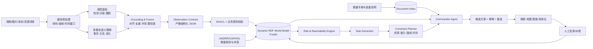

# AI Disaster Commander

## 基于多模态世界模型、RDF 知识图谱与约束规划的智能灾害救援指挥 Agent

> Hackathon Gold Edition · V2 融合方案  
> 建议主赛道场景：地震建筑坍塌救援  
> 开发周期：10 天  
> 产品定位：辅助决策，不替代现场指挥人员

---

## 1. 最终 Pitch

> **AI Disaster Commander 能够理解灾害现场视频，持续构建带时间、空间、证据与不确定性的动态灾害世界模型，并在人员、道路、建筑风险和救援资源约束下，生成可解释、可追溯、可由人确认的救援方案。**

一句更适合路演的表达：

> **让 AI 从“看见灾害”，升级到“理解现场、推演方案、辅助行动”。**

### 为什么它不只是普通视频问答

普通多模态应用通常完成：

```text
视频 → 文字描述 → 一次性回答
```

AI Disaster Commander 完成：

```text
视频/图片
  → 可验证观察
  → 动态 RDF 世界状态
  → 风险与可达性推理
  → 候选救援任务
  → 约束优化与方案比较
  → 带证据、假设和不确定性的行动建议
  → 人工批准或纠错
```

---

## 2. 冲奖策略

评委需要在三分钟内同时看到三件事：

1. **技术不是拼接**：视频理解、世界模型、图谱推理和规划 Agent 形成闭环；
2. **创新能够被看见**：任一结论都能回跳到视频证据，任一建议都能解释推理路径；
3. **作品确实完成**：主流程稳定、测试可展示、模型失败有降级、部署可以复现。

平台架构可以声称支持多灾种，但比赛只演示一个完整场景：

> **地震后建筑局部坍塌：多个区域有人被困、道路部分阻断，系统需要在一个救援队和一架无人机的资源约束下给出行动顺序。**

不要在十天里同时做洪水、火灾、地震和台风。可扩展性由本体和模块接口证明，不靠堆演示场景证明。

---

## 3. 核心创新：Dynamic Disaster World Model

### 3.1 对“世界模型”的准确定位

比赛版不应把一个静态 Scene Graph 包装成“预测型基础世界模型”。建议明确将它定义为：

> **一个由视频观察驱动、按事件增量更新的时空状态模型，能够保存当前灾害状态、历史变化、证据来源、资源约束和候选行动，并支持规则推理与情景模拟。**

它由四层组成：

| 层 | 内容 | 作用 |
|---|---|---|
| Observation Layer | 视频观察、传感器/人工输入、关键帧 | 记录“看到了什么” |
| State Layer | 人员、建筑、道路、危险区、资源及关系 | 维护“当前世界是什么状态” |
| Reasoning Layer | 风险规则、可达性、信息冲突、优先级 | 推导“这意味着什么” |
| Action Layer | 救援任务、资源分配、路线和备选方案 | 回答“下一步可以做什么” |

### 3.2 时间不是字段，而是世界状态演化

系统将视频分成若干时间窗口，产生增量事件 `Δt`：

```text
G(t+1) = Apply(G(t), Δt, HumanCorrections)
```

例如：

```text
00:08  Building A 被识别为局部损坏
00:18  Building A 二层窗口出现 3 名疑似受困人员
00:31  North Road 被落石阻断
00:44  Building A 出现新的扬尘与构件位移线索
```

前端既能显示“当前状态”，也能回放状态如何变化。这一点比静态场景图更接近真正的世界模型。

### 3.3 RDF 是世界模型的结构化记忆

RDF 不作为旁路知识库，而作为世界模型的语义骨架：

- 视频中检测到的对象转为实体；
- 对象之间的空间、时间和因果/约束关系转为边；
- 每次分析运行、每个时间窗口或来源使用命名图隔离；
- 通过 SPARQL 查询世界状态；
- 通过 GeoSPARQL 处理附近、覆盖、相交和区域关系；
- 通过 SHACL 阻止缺少来源、时间或置信度的数据进入“已确认事实”；
- 通过 PROV-O 记录模型、人工和规则推导的来源。

---

## 4. 总体技术架构



### 4.1 推荐技术栈

| 模块 | Hackathon 选择 | 说明 |
|---|---|---|
| 前端 | Next.js/React + TypeScript | 地图、视频时间轴、图谱和任务卡 |
| 地图 | MapLibre GL + OpenStreetMap 数据 | 标记建筑、风险区、道路和路线 |
| 后端 | FastAPI + Pydantic | API、结构化数据验证、自动文档 |
| 视频任务 | Redis + RQ/Celery | 异步分析、进度和重试 |
| 媒体处理 | FFmpeg + OpenCV | 转码、抽帧、关键帧和时间码 |
| 多模态理解 | 可插拔 Video/Vision Model Adapter | 避免业务代码绑定单一厂商 |
| 感知增强 | 目标检测器；SAM 2 作为 P1 跟踪增强 | SAM 2 适合图像/视频对象分割与跨帧跟踪，但不是事件理解模型 |
| RDF | RDFLib + Apache Jena Fuseki | 建图、序列化、SPARQL 查询与持久化 |
| 质量约束 | pySHACL | 入图前执行 RDF 数据校验 |
| 路线与分配 | NetworkX/A* + OR-Tools | 路线可达性、队伍—任务分配、容量和时间约束 |
| Agent 编排 | 明确状态机；可用 LangGraph，也可自定义 | 禁止开放式无限循环 |
| 业务数据 | PostgreSQL；比赛极简版可 SQLite | 用户、任务、文件和分析运行元数据 |
| 部署 | Docker Compose | 本地一条命令启动所有服务 |

Meta 对 SAM 2 的官方定位是图像和视频中的提示式对象分割与跟踪，因此它应服务于跨帧目标一致性，而不是独自承担“建筑损坏判断”。Google OR-Tools 能表达车辆路线、容量、时间窗、资源和调度约束，适合让救援规划从 LLM 文本建议升级为可验证的约束求解。

---

## 5. 多模态感知：从像素到可验证观察

### 5.1 双通道设计

#### 通道 A：视觉感知

负责相对确定的视觉信号：

- 人员、车辆、道路障碍、建筑区域；
- bounding box / mask；
- 跨帧 track id；
- 出现时间和持续时间。

P0 可以使用现成检测器；P1 再加入 SAM 2 做对象分割和跟踪。不要在十天内训练通用灾害视觉模型。

#### 通道 B：多模态语义理解

负责更高层语义：

- 建筑是否存在局部坍塌线索；
- 人员与建筑、道路的关系；
- 道路为何疑似不可通行；
- 场景随时间发生了什么变化；
- 当前信息还缺少什么。

### 5.2 融合规则

- 两通道一致：提升可信等级；
- 只有一个通道支持：保留但标记低置信度；
- 数量或类别冲突：创建 `Conflict`，进入人工复核；
- 同一 track 在相邻时间窗重复出现：合并为一个实体；
- 低于阈值：不进入自动规划，只进入“待核实观察”。

### 5.3 统一 Observation Contract

```json
{
  "observation_id": "obs_0018_0026",
  "source": {
    "video_id": "video_001",
    "start_second": 18,
    "end_second": 26,
    "keyframe_uri": "/evidence/frame_0022.jpg"
  },
  "subject": {
    "type": "AffectedPersonGroup",
    "track_id": "group_01",
    "estimated_count": 3
  },
  "relation": "locatedInside",
  "object": {
    "type": "Building",
    "id": "building_A",
    "zone": "second_floor"
  },
  "confidence": 0.88,
  "verification_status": "unverified",
  "model": {
    "name": "vision-adapter",
    "version": "demo-v1"
  }
}
```

所有模型输出必须先通过这个契约，才能进入图谱。原始模型响应另外保存，便于调试和复现。

---

## 6. RDF 世界模型设计

### 6.1 复用标准词汇

不要从零发明所有概念：

- **SOSA/SSN**：Observation、Sensor、FeatureOfInterest；
- **PROV-O**：模型输出、规则结论、人工确认之间的溯源；
- **OWL-Time**：时间点、时间区间和先后关系；
- **GeoSPARQL**：位置、区域和空间关系；
- **CAP/HXL/UNDRR**：灾情、告警、影响和人道救援字段的对齐；
- **自定义 `adc:` 命名空间**：受困、道路阻断、救援任务、资源能力等业务概念。

### 6.2 核心类

| 类 | 关键字段或关系 |
|---|---|
| `adc:DisasterIncident` | 类型、状态、影响区域 |
| `sosa:Observation` | 观察对象、时间、来源、置信度 |
| `adc:EvidenceSegment` | 视频、时间码、关键帧、模型 |
| `adc:AffectedPersonGroup` | 估计人数、脆弱性线索、位置 |
| `adc:Building` | 损坏线索、区域、进入限制 |
| `adc:RoadSegment` | 开放、受限、阻断、证据 |
| `adc:HazardZone` | 危险类型、范围、状态 |
| `adc:RescueResource` | 类型、能力、容量、可用位置 |
| `adc:RescueTask` | 目标、所需能力、紧急度、状态 |
| `adc:Plan` | 任务顺序、资源分配、路线、假设 |
| `adc:Conflict` | 冲突来源、待确认状态 |

### 6.3 命名图策略

```text
graph/source/video-001       视频直接观察
graph/run/analysis-202       某次模型分析
graph/human/confirmed        人工确认事实
graph/inference/current      当前规则推导
graph/plan/plan-007          某个候选方案
```

命名图使系统能够回答：

- 这条结论来自哪个模型运行？
- 人工确认过吗？
- 规则升级后能否重新推导？
- 为什么当前方案与上一版不同？

### 6.4 SHACL 质量门

例如，进入规划层的观察必须具有：

- `prov:wasDerivedFrom`；
- `time:hasBeginning/time:hasEnd` 或有效时间码；
- `adc:confidence`；
- `adc:verificationStatus`；
- 对规划有影响的地点必须拥有 geometry；
- 人工驳回的观察不得继续参与当前状态推导。

---

## 7. 风险推理：从“概率表演”改为“证据化评估”

原方案中的 `Survival probability: High`、`Collapse probability: 75%` 很容易被评委追问训练数据、标定方法和责任边界。除非拥有经过验证的专门模型，否则比赛版不要输出伪精确概率。

推荐输出：

```yaml
risk_level: HIGH
confidence: MEDIUM
observed_evidence:
  - partial structural collapse visible at 00:42
  - new dust plume at 00:44
  - people observed on second floor at 00:21
inference:
  - entry requires structural assessment
unknowns:
  - aftershock status unavailable
  - internal stairway condition unknown
```

### 7.1 示例规则

```text
R1  有被困人员证据 + 建筑严重损坏线索
    → 创建 SearchAndRescueTask，紧急度 High

R2  目标地点唯一道路被阻断
    → 排除普通车辆路线，建议先无人机复核或替代入口

R3  观察置信度低或感知结果冲突
    → 不直接进入资源分配，创建 VerificationTask

R4  建筑出现新的风险线索且仍有人被困
    → 提升任务紧急度，同时提高救援人员风险惩罚

R5  资源不具备任务所需能力
    → 该资源—任务分配不可行
```

规则输出也必须写回 RDF，并通过 `prov:wasDerivedFrom` 指向证据和规则版本。

---

## 8. Rescue Planning Agent

### 8.1 Agent 不是“自由聊天循环”

采用显式状态机：

```text
OBSERVE
  → GROUND
  → VALIDATE
  → UPDATE_WORLD
  → ASSESS_RISK
  → GENERATE_TASKS
  → SOLVE_PLAN
  → CRITIQUE
  → EXPLAIN
  → WAIT_FOR_HUMAN
```

每一步都有固定输入、输出和失败状态。语言模型主要用于语义抽取、任务草拟和解释；事实查询、路线计算、约束校验与资源分配由工具完成。

### 8.2 Agent 工具

```text
query_world_state()       查询当前 RDF 世界状态
query_evidence()          找到视频时间片和溯源
find_nearby_resources()   GeoSPARQL/地理查询
calculate_route()         排除受阻道路后的路径
retrieve_protocol()       检索救援手册或装备说明
generate_tasks()          根据风险规则创建候选任务
solve_assignment()        求解资源—任务分配
validate_plan()           检查能力、容量、路线、时间约束
compare_plans()           比较主方案与备选方案
```

### 8.3 可验证的规划目标

对每个候选任务计算可解释的 `priority_score`，但不要把它称为真实生存概率：

```text
priority_score =
    affected_people_weight
  + urgency_evidence_weight
  + vulnerability_signal_weight
  + information_gain_weight
  - responder_risk_penalty
  - travel_time_penalty
  - uncertainty_penalty
```

资源分配变量可表示为：

```text
x(resource, task) ∈ {0, 1}
```

约束包括：

- 同一支队伍同一时间只能执行一个任务；
- 队伍能力必须覆盖任务需求；
- 路线不能穿过已确认不可通行道路；
- 无人机、救护车和队伍具有容量与可用时间；
- 低可信任务先执行核实，不能直接触发高风险进入行动。

规划器输出：

1. 推荐方案；
2. 至少一个备选方案；
3. 无法安排的任务；
4. 每个选择的约束依据；
5. 哪个未知信息最可能改变方案。

### 8.4 反事实演示

这是非常有冲击力的加分项：

> “如果只有一支救援队，先去哪里？”

系统给出 Plan A。用户随后把 `North Road` 改为“确认阻断”，或把队伍能力改为“不具备结构救援资质”，系统重新求解并切换到 Plan B，同时展示方案变化原因。

这比让 LLM 再生成一段不同文字，更能证明系统真的拥有动态世界状态和规划能力。

---

## 9. GraphRAG 与自然语言查询

系统包含两种知识：

| 知识 | 存储 | 用途 |
|---|---|---|
| 现场事实、状态、关系、任务、资源 | RDF | 精确查询、关系推理、溯源 |
| 救援手册、装备说明、处置流程 | 文档索引 | 检索操作性背景知识 |

查询流程：

```text
自然语言问题
→ 问题分类与槽位抽取
→ 选择经过测试的 SPARQL/GeoSPARQL 模板
→ 获取实体、关系路径和 evidence URI
→ 以图谱实体为锚点检索手册
→ 生成回答
→ 显示事实、推断、未知与引用证据
```

示例问题：

- “Building A 现在有哪些已确认风险？”
- “哪些受困人员无法通过车辆路线抵达？”
- “为什么系统优先派无人机去 Building C？”
- “如果 North Road 恢复通行，任务顺序会怎样变化？”
- “只显示尚未人工确认、但会影响当前方案的观察。”

不要让模型直接执行任意 SPARQL。采用模板白名单和参数化查询，保证安全性与可测试性。

---

## 10. 前端：Command Center

主屏只保留四个联动区域：

```text
┌─────────────────────┬─────────────────────┐
│ 现场视频 + 时间轴    │ 灾害地图 + 路线       │
│ 检测框/证据时间片     │ 建筑/道路/危险区/资源  │
├─────────────────────┼─────────────────────┤
│ 当前世界状态/局部图谱 │ Rescue Plan          │
│ 已知·推断·未知         │ 主方案·备选·原因·约束  │
└─────────────────────┴─────────────────────┘
```

交互原则：

- 点击计划理由 → 高亮对应图谱路径；
- 点击图谱 Observation → 视频跳到证据时间片；
- 点击地图对象 → 展示当前状态和历史变化；
- 点击“确认/驳回” → 世界状态和规划增量更新；
- 图谱只展示与当前任务有关的局部子图，避免变成彩色蜘蛛网。

---

## 11. 三分钟金奖 Demo 故事线

### 0:00–0:20：冲突与目标

> “灾害发生后，真正困难的不是缺少视频，而是视频碎片无法立刻转化成可执行决策。今天我们让 AI 在三分钟内完成从现场理解到救援方案。”

展示：一个救援队、一架无人机、一辆救护车，三个待评估区域。

### 0:20–0:55：上传并理解视频

- 上传 60–90 秒地震视频；
- 时间轴陆续出现人员、建筑、道路观察；
- 展示一个跨帧跟踪对象和一个语义事件；
- 点击观察，跳转到关键帧。

### 0:55–1:25：世界模型生成

- 地图出现 Building A/B/C、North Road 和资源位置；
- 图谱建立 `People → inside → Building A`、`Road → blocksAccessTo → Building A`；
- 展示事实、推断、未知三层。

### 1:25–2:05：Agent 规划

用户问：

> “如果只有一支救援队，应该先去哪里？”

系统输出：

```yaml
recommended_plan:
  first: Drone verification at Building C
  second: Rescue Team 1 to Building A via East Route
  ambulance: Stage at Safe Zone S1

reason:
  - 3 persons observed at Building A
  - North Road is blocked
  - East Route remains passable
  - Building C evidence is uncertain; drone verification has high information value

unknowns:
  - internal access condition at Building A
```

### 2:05–2:35：反事实变化

人工确认 East Route 也被阻断。系统重新计算：

- 原方案被标为不可行；
- Plan B 启用；
- 图谱显示变化来自哪条新事实；
- 规划解释同步更新。

### 2:35–3:00：总结

> “我们没有让大模型替代指挥员。AI 负责把视频变成动态世界状态，用规则和约束求解候选方案，并把每个结论还原到证据；最终决策仍由人完成。”

---

## 12. 10 天开发计划

### Day 1：冻结故事和数据契约

- 固定地震场景、3 个地点、3 类资源；
- 准备 1 条主演示视频和 10–20 条测试片段；
- 冻结 Observation JSON、最小本体和 15 个验收问题；
- 写完三分钟脚本。

**完成标准：** 可以手工从主视频产出完整预期 JSON、RDF 和救援方案。

### Day 2：项目骨架

- Monorepo、Docker Compose、CI、格式化、静态检查；
- 文件上传、任务状态、健康检查；
- Fuseki、数据库、Redis 启动；
- 前后端共享 schema。

### Day 3：视频理解 P0

- 转码、抽帧、关键帧、时间码；
- 接入多模态模型适配器；
- 严格 JSON 输出；
- 保存模型原始响应和调用元数据。

### Day 4：Grounding 与融合

- 加入人员/车辆/道路障碍检测；
- 做 track、时间窗口合并、去重和冲突；
- SAM 2 只有在主链路稳定后再加入。

### Day 5：动态 RDF 世界模型

- JSON → RDF；
- SOSA/PROV-O/OWL-Time/GeoSPARQL 对齐；
- 命名图、SHACL 和人工确认图；
- 当前状态物化与历史回放。

### Day 6：风险规则与规划器

- 5–8 条可解释规则；
- 建立道路图；
- 完成资源—任务分配和路线约束；
- 输出主方案、备选和不可行原因。

### Day 7：Agent 与 GraphRAG

- 固定 Agent 状态机；
- SPARQL 模板和槽位抽取；
- 文档检索；
- 事实/推断/未知分层回答。

### Day 8：Command Center

- 视频、地图、图谱和计划联动；
- 确认/驳回；
- 完成反事实重规划；
- 优化演示视觉效果。

### Day 9：质量与材料

- 单元、契约、集成、E2E 测试；
- 性能、日志、trace id、幂等；
- README、架构图、数据字典、模型限制；
- 预计算结果和备份演示视频。

### Day 10：冻结与彩排

- 不再加功能；
- 干净环境部署；
- 连续演示 5 次；
- 准备评委追问答案。

---

## 13. MVP 与加分项

### P0：必须完成

- 单视频上传和异步处理；
- 5–8 类观察；
- 时间码和关键帧证据；
- 动态 RDF 状态、SHACL、SPARQL；
- 视频/地图/图谱联动；
- 5–8 条风险规则；
- 一个资源约束规划问题；
- 人工确认后重新规划；
- 主方案与备选方案解释。

### P1：时间允许再做

- SAM 2 视频分割和跟踪；
- 两段视频合并同一现场；
- GeoSPARQL 完整空间函数；
- 文档 GraphRAG；
- CAP/HXL 导出；
- 世界状态历史回放。

### 明确不做

- 训练通用灾害基础模型；
- 同时展示多个灾种；
- 宣称真实生存率或坍塌概率；
- 自动向机器人或救援队下发指令；
- 开放式自主 Agent 无限循环；
- 为了架构图好看而拆十几个微服务。

如果是单人开发，首先删除 P1 中的 SAM 2、跨视频合并和 CAP/HXL 导出，但保留 RDF、证据回跳和重规划，因为这三项构成作品的差异化核心。

---

## 14. 代码质量如何让评委看得见

1. **一条命令启动**：前端、API、Worker、Fuseki、Redis 和数据库都有健康检查。
2. **严格数据门**：模型输出过 JSON Schema；图谱数据过 SHACL；方案再过约束验证。
3. **模型适配器**：更换 VLM 不影响 Observation Contract 和业务逻辑。
4. **幂等分析**：同一视频、模型版本和配置不会重复创建世界实体。
5. **可重放**：保存原始响应、事件增量和规则版本，可以重建任意时刻状态。
6. **测试分层**：
   - 单元：时间合并、实体去重、置信度融合、评分；
   - 契约：模型输出、API、RDF 映射；
   - 集成：SHACL、SPARQL、规划器；
   - E2E：上传→分析→问答→确认→重规划。
7. **可观测性**：一个分析任务使用统一 trace id，展示各步骤耗时。
8. **明确失败模式**：模型超时、图谱不可用、规划不可行都返回可理解状态，而非静默失败。

### 推荐目录

```text
apps/web/
services/api/
services/media_worker/
services/perception_worker/
services/world_model/
services/planner/
packages/contracts/
ontology/ontology.ttl
ontology/shapes.ttl
ontology/rules/
tests/golden/
infra/docker-compose.yml
```

---

## 15. 验收指标

| 维度 | 指标 |
|---|---|
| 感知 | 选定事件类型 Precision/Recall/F1；事件时间偏差 |
| 跟踪 | 主演示对象 track 连续性 |
| 图谱 | SHACL 通过率、重复实体率、溯源完整率 |
| 查询 | 15 个固定问题的 SPARQL 结果正确率与证据命中率 |
| 规划 | 约束违反数必须为 0；主方案/备选生成成功率 |
| 人机协作 | 纠错到状态和方案更新的端到端延迟 |
| 系统 | 视频处理耗时、问答 P95、连续演示成功率 |

建议比赛目标：

- 进入“已确认事实”层的 RDF 100% 通过 SHACL；
- 所有关键回答 100% 带 evidence URI；
- 固定查询集正确率至少 80%；
- 所有输出方案的硬约束违反数为 0；
- 人工纠错后 2 秒内完成图谱和方案更新；
- 主演示连续运行 5 次不失败。

---

## 16. 评委最可能追问的问题

### Q1：这真的是世界模型吗？

回答：它不是声称学习完整物理规律的生成式世界模型，而是一个事件驱动的时空灾害状态模型。它保存对象、关系、状态变化、证据、约束和行动，并支持状态更新、查询和反事实重规划。我们准确限定了能力边界。

### Q2：为什么一定要 RDF，普通数据库不行吗？

回答：业务任务和文件元数据仍适合关系数据库；RDF 专门处理灾害现场不断变化的异构实体和关系。它允许我们把视频观察、人员、建筑、道路、资源、规则和方案连接起来，并通过标准查询和溯源回答“为什么”。

### Q3：为什么不让大模型直接给方案？

回答：语言模型擅长理解和解释，但不适合保证资源容量、队伍能力、路线和时间约束。我们的 Agent 调用图查询、路径计算和约束求解器，最后再由模型解释，方案还需人工批准。

### Q4：视频识别错了怎么办？

回答：每个观察都有置信度和证据；两条感知通道冲突会进入待复核；低可信观察不能直接参与高风险规划；人工确认或驳回会增量更新世界状态和方案。

### Q5：十天真的做得完吗？

回答：不训练模型、不覆盖多灾种，只完成一个地震场景、一个资源分配问题和一条完整闭环。SAM 2、跨视频融合和标准导出都是 P1，不阻塞主线。

---

## 17. 项目命名与品牌结构

建议保留你原来的主名称：

# **AI Disaster Commander**

副标题：

> **From Disaster Footage to Verifiable Rescue Plans**  
> 从灾害视频到可验证的救援方案

内部技术模块可以命名为：

- **RescueGraph**：动态 RDF 世界模型；
- **GroundSight**：多模态感知与证据融合；
- **PlanGuard**：约束规划与方案校验；
- **Command Center**：人机协同指挥界面。

这种结构保留了“Commander”的舞台冲击力，也避免让整个作品听起来像一个普通知识图谱项目。

---

## 18. 参考标准与技术依据

- [RDF 1.1 Concepts — W3C](https://www.w3.org/TR/rdf11-concepts/)
- [SPARQL 1.1 Query Language — W3C](https://www.w3.org/TR/sparql11-query/)
- [SHACL — W3C](https://www.w3.org/TR/shacl/)
- [PROV-O — W3C](https://www.w3.org/TR/prov-o/)
- [OWL-Time — W3C](https://www.w3.org/TR/owl-time/)
- [SOSA/SSN — W3C](https://www.w3.org/TR/vocab-ssn/)
- [GeoSPARQL 1.1 — OGC](https://www.ogc.org/standards/geosparql/)
- [Apache Jena Fuseki](https://jena.apache.org/documentation/fuseki2/)
- [Common Alerting Protocol 1.2 — OASIS](https://docs.oasis-open.org/emergency/cap/v1.2/CAP-v1.2-os.html)
- [Humanitarian Exchange Language](https://hxlstandard.org/)
- [UNDRR Disaster Risk Reduction Terminology](https://www.undrr.org/drr-glossary/terminology)
- [SAM 2 — Meta AI](https://ai.meta.com/research/sam2/)
- [Google OR-Tools](https://developers.google.com/optimization)

---

## 19. 最终答辩总结

> **AI Disaster Commander 不是让大模型替代救援指挥员，而是把分散的视频信息转换成可验证、可持续更新的灾害世界状态。系统以 RDF 连接人员、建筑、道路、风险、资源和证据，以规则与约束优化生成候选救援方案，并通过 Agent 向人解释每一个选择、假设和未知信息。它让 AI 从一次性的“看图说话”，升级为可审计的人机协同决策系统。**
