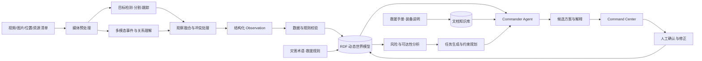

# AI Disaster Commander

## 基于多模态世界模型的智能灾害救援决策支持平台

> 产品介绍版  
> 产品定位：面向灾害响应与应急指挥场景，将现场视频转化为可验证的态势信息和可解释的救援方案。

---

## 1. 产品一句话介绍

> **AI Disaster Commander 是一个面向灾害救援场景的多模态智能决策支持平台，能够理解现场视频和图像，持续构建动态灾害世界模型，并结合人员、道路、建筑风险和救援资源，为指挥人员生成可解释、可追溯的行动建议。**

更简短的表达：

> **从灾害视频到可验证的救援方案。**

英文表达：

> **From disaster footage to verifiable rescue plans.**

---

## 2. 产品定位

AI Disaster Commander 不是一个简单的视频识别工具，也不是一个自动替代指挥人员做决定的系统。

它的定位是：

> **灾害现场的智能信息分析与决策支持平台。**

产品负责完成三件事：

1. 将分散的视频、图像、地图和资源信息整理成统一的现场状态；
2. 分析人员、建筑、道路、危险区域和救援资源之间的关系；
3. 在明确的资源与安全约束下生成候选行动方案，并向指挥人员解释依据。

最终行动仍由现场指挥人员确认。

---

## 3. 产品要解决的问题

灾害发生后，现场往往并不缺少信息，而是缺少将信息快速转化成行动的能力。

### 3.1 信息来源分散

现场信息可能来自：

- 无人机视频；
- 手机拍摄视频；
- 固定监控；
- 卫星或航拍图像；
- 救援人员报告；
- 地图和道路数据；
- 救援队伍与装备清单。

这些信息格式不同、时间不同、可信程度不同，难以形成统一态势。

### 3.2 现场状态持续变化

建筑可能继续发生局部坍塌，道路可能从受限变为阻断，人员和救援资源的位置也在变化。

传统报告通常只能描述某一个时间点，无法持续表达：

- 发生了什么变化；
- 哪条结论已经失效；
- 哪个变化会影响当前方案。

### 3.3 决策需要同时考虑多种约束

救援行动需要综合考虑：

- 被困人数与紧急程度；
- 建筑和环境风险；
- 道路可达性；
- 队伍能力与装备；
- 到达时间和任务顺序；
- 信息可靠程度；
- 对救援人员自身的风险。

单纯依靠视频标签或大模型生成的一段文字，无法稳定处理这些相互关联的约束。

---

## 4. 产品解决方案

AI Disaster Commander 将整个过程组织成一条连续链路：

```text
现场视频、图像和资源信息
        ↓
多模态感知与事件提取
        ↓
动态灾害世界模型
        ↓
风险、关系与可达性分析
        ↓
救援任务生成与资源规划
        ↓
带证据的候选行动方案
        ↓
人工确认、修正和重新规划
```

与普通视频问答不同，系统不会只生成一次性描述。视频中识别出的人员、建筑、道路和风险都会成为持续更新的结构化状态，并与原始证据保持关联。

---

## 5. 主要用户

### 5.1 应急指挥人员

需要快速建立现场全局态势、比较行动方案并分配资源。

### 5.2 一线救援队伍

需要了解任务目标、进入路线、现场风险、信息来源和未确认事项。

### 5.3 无人机与现场勘察人员

需要知道哪些区域信息不足、下一次侦察应该重点覆盖哪里。

### 5.4 应急管理和技术支持团队

需要保存分析过程、追溯信息来源，并在事件结束后复盘决策过程。

### 5.5 基础设施与园区安全团队

可以将产品用于大型园区、矿区、交通枢纽或工业设施的应急响应。

---

## 6. 典型使用场景

产品架构可以扩展到多种灾害类型，早期产品建议集中在具有明显空间、人员和道路关系的场景。

### 6.1 地震建筑坍塌

- 识别疑似被困人员；
- 标记建筑损坏线索；
- 判断道路是否受阻；
- 规划无人机复核和救援队进入顺序。

### 6.2 城市内涝

- 识别被困人员和车辆；
- 分析积水区域变化；
- 判断车辆和救生艇可达性；
- 匹配避难点与转运资源。

### 6.3 山火与工业火灾

- 标记火线、烟雾和危险区域；
- 识别受影响设施；
- 结合道路和风向信息规划人员撤离；
- 管理消防与医疗资源。

### 6.4 灾后巡检与复盘

- 汇总多个视频来源；
- 回放现场状态变化；
- 追踪哪些判断来自模型、人工或规则；
- 为事件报告和流程改进提供依据。

---

## 7. 核心产品能力

### 7.1 多模态现场理解

系统接收视频、图像、地图位置和人工补充信息，识别：

- 人员与疑似被困群体；
- 建筑、道路、车辆和重要设施；
- 局部坍塌、道路障碍、烟雾、积水等可见线索；
- 人员与建筑、道路、危险区域之间的关系；
- 现场在不同时间段发生的变化。

系统采用视觉检测与多模态语义理解相结合的方式：视觉模型负责对象和跨帧一致性，多模态模型负责事件、关系和场景语义。

### 7.2 动态灾害世界模型

系统将每次观察转化为持续更新的世界状态：

```text
人员 → 位于 → Building A 二层
Building A → 存在 → 局部坍塌线索
North Road → 状态 → 已阻断
North Road → 阻断通往 → Building A
Rescue Team 1 → 具备能力 → 结构搜救
```

世界模型不仅保存“现在有什么”，还保存：

- 信息在什么时间出现；
- 来自哪段视频或哪位人员；
- 当前是否经过人工确认；
- 哪些结论由规则推导；
- 状态发生过怎样的变化。

### 7.3 证据化态势分析

每条重要结论都可以回到原始证据：

- 来源视频；
- 起止时间；
- 关键帧；
- 模型和版本；
- 置信度；
- 人工确认状态。

用户点击“Building A 有 3 名疑似被困人员”，系统会直接跳转到对应的视频时间片，而不是只显示一段无法核验的文字。

### 7.4 风险与信息缺口分析

系统输出不使用未经验证的伪精确概率，而是区分：

- **已观察事实**：由视频、传感器或人工报告直接支持；
- **系统推断**：由规则和多个事实共同推导；
- **待确认信息**：当前证据不足或来源冲突；
- **关键未知项**：一旦确认，可能改变当前方案的信息。

示例：

```yaml
risk_level: HIGH
observed_evidence:
  - partial structural collapse visible at 00:42
  - 3 persons observed on second floor at 00:21
inference:
  - structural assessment is required before entry
unknowns:
  - internal stairway condition
  - secondary collapse indicators
```

### 7.5 救援任务与资源规划

系统根据当前世界状态生成候选任务，例如：

- 无人机复核；
- 人员搜救；
- 医疗转运；
- 道路清理；
- 危险区域封控；
- 信息补充。

规划过程同时考虑：

- 任务紧急程度；
- 队伍专业能力；
- 资源容量；
- 道路和路线状态；
- 到达时间；
- 救援人员风险；
- 信息可靠程度。

系统输出推荐方案、备选方案、无法执行的任务和每个选择的依据。

### 7.6 自然语言查询

用户可以直接提问：

- “Building A 当前有哪些已确认风险？”
- “哪些被困人员无法通过车辆路线抵达？”
- “为什么系统建议先派无人机去 Building C？”
- “如果 North Road 恢复通行，行动顺序会发生什么变化？”
- “哪些未确认信息会影响当前救援方案？”

系统从结构化世界模型中查询事实和关系，再结合救援流程文档组织回答。

### 7.7 人工确认与动态重规划

指挥人员可以确认、修改或驳回 AI 观察。

例如，人工确认 East Route 已经阻断后：

1. 道路状态被更新；
2. 原路线被判定为不可行；
3. 受影响的任务被重新计算；
4. 系统生成新的候选方案；
5. 界面说明方案变化由哪条新信息引起。

---

## 8. 产品界面

产品主界面采用 Command Center 形式：

```text
┌─────────────────────┬─────────────────────┐
│ 现场视频与事件时间轴 │ 灾害地图与行动路线    │
│ 检测结果、证据时间片 │ 建筑、道路、风险和资源 │
├─────────────────────┼─────────────────────┤
│ 当前世界状态与关系图 │ 候选救援方案          │
│ 已知、推断、未知信息 │ 主方案、备选和约束依据 │
└─────────────────────┴─────────────────────┘
```

四个区域相互联动：

- 点击地图建筑，可以查看当前状态和历史变化；
- 点击图谱观察，可以跳转到视频证据；
- 点击方案理由，可以高亮对应的实体和关系；
- 修改现场状态后，方案会重新计算。

---

## 9. 产品技术架构



### 9.1 世界模型的标准基础

RDF 世界模型可以复用成熟标准：

- SOSA/SSN：观察、传感器和被观察对象；
- PROV-O：模型、规则和人工操作的来源；
- OWL-Time：时间点、时间区间和状态顺序；
- GeoSPARQL：位置、区域和空间关系；
- SHACL：知识图谱的数据质量约束；
- CAP、HXL、UNDRR：与灾害和人道救援术语进行映射。

### 9.2 规划系统

语言模型负责理解问题、组织任务和解释结果，但不独自决定路线与资源分配。

规划工具负责：

- 路线搜索；
- 队伍与任务匹配；
- 容量和时间约束；
- 不可行方案检测；
- 主方案与备选方案比较。

这种分工使系统既保留自然交互能力，也能够对关键约束进行程序化验证。

---

## 10. Commander Agent 工作流程

```text
OBSERVE             接收现场观察
  ↓
GROUND              将对象与现有世界实体对齐
  ↓
VALIDATE            检查结构、证据和冲突
  ↓
UPDATE WORLD        更新动态世界状态
  ↓
ASSESS              分析风险、可达性和信息缺口
  ↓
GENERATE TASKS      生成候选救援与核实任务
  ↓
SOLVE               完成路线和资源约束规划
  ↓
CRITIQUE            检查方案限制和备选方案
  ↓
EXPLAIN             生成人可理解的理由
  ↓
WAIT FOR HUMAN      等待确认、修改或补充信息
```

Agent 可以使用的工具包括：

```text
query_world_state()
query_evidence()
find_nearby_resources()
calculate_route()
retrieve_protocol()
generate_tasks()
solve_assignment()
validate_plan()
compare_plans()
```

---

## 11. 产品差异化

### 11.1 与传统视频识别系统的区别

传统系统输出对象标签；AI Disaster Commander 输出持续更新的现场关系、风险和任务。

### 11.2 与普通多模态聊天产品的区别

普通聊天回答通常是一次性的；本产品将观察写入结构化世界模型，可以跨视频查询、纠错、追溯和重新规划。

### 11.3 与传统知识库的区别

传统知识库主要保存静态资料；本产品同时维护实时现场状态、视频证据、救援资源和行动方案。

### 11.4 与自动指挥系统的区别

本产品不自动下达高风险行动指令，而是提供经过约束检查的候选方案，由人类指挥人员做最终决定。

### 11.5 关键差异总结

```text
多模态感知
+ 动态世界模型
+ RDF 关系与证据溯源
+ 规则和约束规划
+ 人工确认与重规划
= 可审计的灾害决策支持
```

---

## 12. 产品价值

### 12.1 更快形成统一态势

减少人工逐段查看视频和手工整理信息的时间。

### 12.2 降低信息遗漏

系统持续记录人员、道路、建筑和资源之间的关系，并主动暴露信息缺口。

### 12.3 让建议可以核验

每个重要结论都能回到原始证据，每个方案都能说明采用和排除的原因。

### 12.4 支持动态调整

现场信息变化后，系统能够判断哪些任务和方案受到影响，并重新计算。

### 12.5 沉淀可复用的事件数据

事件结束后可以回放状态变化和决策过程，用于复盘、训练和流程改进。

---

## 13. 产品能力边界

为了避免误导用户，需要明确说明：

- 产品提供辅助分析，不替代专业救援指挥；
- 视频中不可见的信息不能被系统当作事实；
- 风险结论需要显示证据、置信程度和未知项；
- 未经过验证的模型输出不能直接触发高风险行动；
- 系统不输出缺乏专门模型和数据支持的伪精确生存率或坍塌概率；
- 任何面向机器人、无人机或救援队的自动执行，都需要额外的授权、安全机制和现场验证。

---

## 14. 产品发展路径

### 阶段一：单现场分析

- 单段视频或图片分析；
- 人员、建筑、道路和危险线索；
- 动态世界状态；
- 证据化查询；
- 简单任务和资源规划；
- 人工确认与重新规划。

### 阶段二：多源态势融合

- 多架无人机和多段视频；
- 传感器和人工报告；
- 跨来源实体对齐和冲突处理；
- 更完整的地理和道路分析；
- 指挥中心协同工作流。

### 阶段三：组织级应急平台

- 接入现有应急管理系统；
- 资源台账和队伍能力库；
- 标准化告警和数据交换；
- 权限、审计和事件归档；
- 不同灾种的专业规则包。

### 阶段四：受控的设备协同

- 无人机侦察任务建议；
- 机器人现场探测；
- 多设备任务协调；
- 在严格人工授权和安全边界下执行低风险任务。

---

## 15. 产品效果指标

### 信息处理

- 从视频上传到首批现场观察的时间；
- 关键事件识别准确率；
- 事件时间定位误差；
- 跨视频实体重复率。

### 世界模型

- 数据质量校验通过率；
- 证据来源完整率；
- 人工纠错后的状态更新时间；
- 历史状态可重放率。

### 查询与规划

- 标准问题查询正确率；
- 回答证据命中率；
- 方案硬约束违反数；
- 无可行方案时的正确识别率；
- 现场信息变化后的重规划时间。

### 用户价值

- 建立初始态势所需时间；
- 人工查看视频时长的减少比例；
- 信息缺口发现数量；
- 用户确认或纠正 AI 观察所需步骤；
- 指挥人员对解释清晰度和可用性的评价。

---

## 16. 如何向别人介绍这个产品

### 16.1 15 秒介绍

> AI Disaster Commander 能把无人机、监控和手机拍摄的灾害视频，转换成持续更新的现场地图和世界模型，并结合道路、风险和救援资源，为指挥人员生成带证据的候选救援方案。

### 16.2 30 秒介绍

> 灾害发生后，现场通常会产生大量视频和图片，但这些信息很难迅速转化成行动。AI Disaster Commander 会识别视频中的人员、建筑、道路和危险线索，把它们组织成动态灾害世界模型，再结合救援队伍、装备和路线约束生成候选方案。每一条结论都可以回到原始视频核验，现场信息变化后，方案也会随之更新。

### 16.3 1 分钟介绍

> AI Disaster Commander 是一个面向灾害救援的多模态智能决策支持平台。它首先分析无人机、监控或手机视频，识别人员、建筑损坏、道路阻断和环境风险。与普通视频识别不同，系统不会只输出标签，而是把这些信息转化为一个持续更新的动态世界模型，记录对象之间的关系、状态变化、证据来源和不确定性。随后，系统结合救援队伍、装备能力、道路状态和任务紧急程度，生成经过约束检查的候选行动方案。指挥人员可以查看每个建议的证据、修改错误信息，并让系统重新规划。它的目标不是替代救援人员，而是在信息最混乱、时间最紧迫的时候，帮助人更快形成统一态势并做出有依据的决定。

### 16.4 3 分钟产品介绍结构

#### 第一部分：问题

> 灾害现场并不缺视频，缺的是把分散视频快速变成统一态势和行动方案的能力。

介绍信息碎片化、现场变化快和多资源约束三个问题。

#### 第二部分：产品如何工作

展示完整流程：

```text
上传视频
→ 识别人员、建筑与道路
→ 形成灾害地图和世界状态
→ 生成候选任务
→ 规划资源和路线
→ 展示证据和备选方案
```

#### 第三部分：现场变化

修改一条关键事实，例如确认某条道路已经阻断。展示系统如何让原方案失效，并重新生成可行方案。

#### 第四部分：产品价值

> 系统的核心价值不是替人做决定，而是让每个决定建立在统一、可更新、可追溯的信息基础上。

---

## 17. 面向不同对象的介绍方式

### 17.1 面向应急管理部门

重点介绍：

- 多源信息汇总；
- 统一现场态势；
- 人工确认和审计；
- 与现有应急流程和数据标准的集成；
- 事件复盘能力。

推荐表达：

> 这是一个将现场视频、地图、资源和人工报告组织成统一态势的决策支持平台，帮助指挥人员更快发现风险、信息缺口和资源冲突。

### 17.2 面向一线救援人员

重点介绍：

- 任务目标是否清晰；
- 路线和危险区域；
- 信息来自哪里；
- 哪些事项尚未确认；
- 如何快速纠正系统。

推荐表达：

> 系统把复杂现场信息整理成任务、路线和风险提示，并允许救援人员直接确认或纠正，不要求一线人员理解底层 AI 和知识图谱。

### 17.3 面向技术团队

重点介绍：

- 多模态感知；
- 动态 RDF 世界模型；
- 时间、空间和溯源标准；
- 受控 Agent 状态机；
- 图查询、路线计算和约束优化；
- 数据质量与可重放性。

推荐表达：

> 产品把多模态模型的非结构化输出转换成经过验证的 Observation，通过 RDF 保存时空状态和证据，再由规则、地理查询和约束优化生成可验证方案。语言模型负责理解和解释，不负责绕过硬约束做最终决策。

### 17.4 面向合作伙伴或管理者

重点介绍：

- 缩短态势建立时间；
- 降低人工整理成本；
- 支持已有视频与无人机设备；
- 产品可以先从单一场景试点；
- 输出可追溯，责任边界明确。

推荐表达：

> 我们不要求重新建设全部现场设备，而是把已有的视频、地图和资源数据转化成一个可持续更新的智能指挥界面，从单一灾害场景开始逐步接入现有应急系统。

---

## 18. 产品演示建议

演示不需要先讲模型名称，先让用户看到产品价值：

1. 上传一段地震现场视频；
2. 视频时间轴自动出现人员、建筑和道路事件；
3. 地图和关系图同步形成现场状态；
4. 提问：“如果只有一支救援队，应该先去哪里？”；
5. 展示推荐方案、备选方案、证据和未知信息；
6. 人工确认一条道路阻断；
7. 展示方案自动失效并重新规划；
8. 最后再解释背后的多模态模型、RDF 世界模型和约束规划。

产品演示的重点不是“AI 能说多少”，而是：

- 能否看到现场关系；
- 能否回到原始证据；
- 能否处理信息变化；
- 能否解释方案为什么改变。

---

## 19. 常见问题

### 这是自动救援指挥系统吗？

不是。它生成候选方案、解释依据并暴露信息缺口，最终行动由具备权限的指挥人员确认。

### 为什么需要 RDF，普通数据库不够吗？

文件、用户和任务元数据仍然可以存储在关系数据库中。RDF 用于表达不断变化的人员、建筑、道路、风险、资源、证据和方案之间的复杂关系，使系统能够进行关系查询、溯源和增量推理。

### 如果 AI 识别错误怎么办？

每条观察都有证据、置信度和确认状态。低可信或相互冲突的结果不会直接参与高风险规划；用户可以确认、修改或驳回，系统随后更新世界状态和方案。

### 系统能处理实时视频吗？

产品架构支持从离线视频逐步扩展到流式输入。早期版本适合先处理短视频或分段视频，在验证稳定性后再接入实时无人机流。

### 它能连接无人机或机器人吗？

可以作为后续扩展，但自动执行需要额外的身份授权、通信可靠性、安全策略和现场测试。产品当前首先聚焦分析和决策支持。

---

## 20. 品牌表达

### 产品名称

**AI Disaster Commander**

### 技术模块

- **GroundSight**：多模态感知与观察融合；
- **RescueGraph**：动态 RDF 灾害世界模型；
- **PlanGuard**：风险、路线和资源约束规划；
- **Command Center**：人机协同指挥界面。

### 推荐标语

中文：

> **让每一条现场信息，转化成可验证的行动依据。**

英文：

> **Turning disaster intelligence into accountable action.**

### 最终产品总结

> **AI Disaster Commander 将现场视频、地图、救援资源和专业知识组织成持续更新的灾害世界模型，通过证据溯源、关系推理和约束规划，为救援指挥人员提供可理解、可修正、可重新计算的候选行动方案。**

---

## 21. 技术与标准参考

- [RDF 1.1 Concepts — W3C](https://www.w3.org/TR/rdf11-concepts/)
- [SPARQL 1.1 Query Language — W3C](https://www.w3.org/TR/sparql11-query/)
- [SHACL — W3C](https://www.w3.org/TR/shacl/)
- [PROV-O — W3C](https://www.w3.org/TR/prov-o/)
- [OWL-Time — W3C](https://www.w3.org/TR/owl-time/)
- [SOSA/SSN — W3C](https://www.w3.org/TR/vocab-ssn/)
- [GeoSPARQL — OGC](https://www.ogc.org/standards/geosparql/)
- [Apache Jena Fuseki](https://jena.apache.org/documentation/fuseki2/)
- [Common Alerting Protocol — OASIS](https://docs.oasis-open.org/emergency/cap/v1.2/CAP-v1.2-os.html)
- [Humanitarian Exchange Language](https://hxlstandard.org/)
- [UNDRR Disaster Risk Reduction Terminology](https://www.undrr.org/drr-glossary/terminology)
- [SAM 2 — Meta AI](https://ai.meta.com/research/sam2/)
- [Google OR-Tools](https://developers.google.com/optimization)
